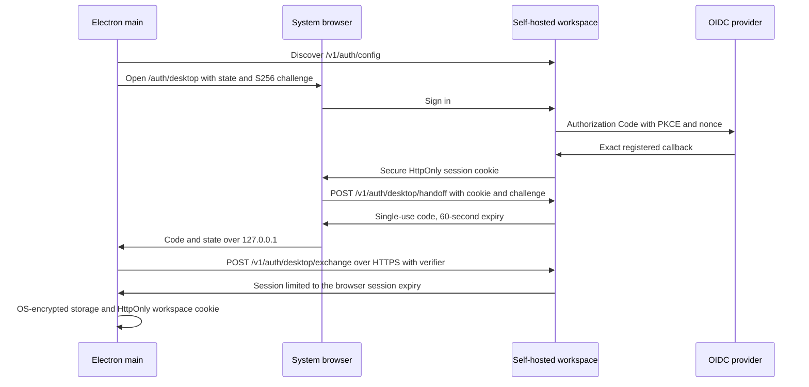

# Self-hosted OIDC and desktop trial

This fork ports upstream PR #719 (`4eef63da933e5dfc060c857fb7420df99207cb80`) onto `d05d85b2ec1a947f1919ed6dcd84b1f68ea76010`. Existing migrations are preserved; OIDC identity fields are migration 090 and desktop handoffs are 091. Deployment-specific origins, identity resources, secrets and packaging commands belong in the operator's private repository.

Set `AUTH_MODE=oidc`, a confidential `OIDC_CLIENT_ID` and `OIDC_CLIENT_SECRET`, `OIDC_ISSUER`, the exact `OIDC_REDIRECT_URI`, `FRONTEND_BASE_URL`, matching `CORS_ORIGINS`, and a random `WORKSPACE_SESSION_SECRET` of at least 32 characters. Use HTTPS, `OIDC_COOKIE_SECURE=true`, `OIDC_REQUIRE_EMAIL_VERIFICATION=true`, `OIDC_SCOPES="openid profile email"` and `WORKSPACE_SESSION_TTL_DAYS=1`. Set `NEXT_PUBLIC_API_URL` to the self-hosted origin and `NEXT_PUBLIC_AUTH_MODE=oidc` at frontend build time so a failed discovery cannot send a user to hosted authentication.

Browser identity is keyed by issuer and subject, never implicitly linked to an existing account by email. Verified invitation placeholders can be claimed on first login. Application sessions last at most 24 hours with this configuration and OIDC sessions cannot be renewed. Admission removal does not revoke an existing application JWT: remove application membership too, or rotate the application signing secret when immediate invalidation is necessary.

Handoff codes are stored only as SHA-256 hashes and consumed with `DELETE ... RETURNING`. Incorrect verifiers cannot consume a valid code. Signing-key rotation invalidates pending codes. Session credentials never enter loopback URLs, renderer IPC or renderer storage in OIDC mode. The remote workspace remains barred from privileged local-agent IPC; only account and notification events are admitted from the configured workspace origin.

For macOS trial packaging, set `OPENAGENTS_TRIAL_ORIGIN`, `OPENAGENTS_TRIAL_APP_ID` and `OPENAGENTS_TRIAL_NAME`, run the launcher build, then run `electron-builder --config electron-builder.trial.cjs --mac --arm64 --x64 --publish never`. This uses a separate identity, ad-hoc signing, no upstream notarization credentials and no updater feed. Launcher/core automatic updates and vendor analytics are disabled in trial builds. Ad-hoc builds require operator-assisted Gatekeeper acceptance and are not production distribution artifacts.

Focused validation: backend `tests/test_oidc_auth.py`, `tests/test_desktop_auth.py`, `tests/test_workspace_session.py`; frontend auth, session and desktop-handoff tests plus TypeScript; launcher account, endpoint, handoff, remote-origin restrictions and TypeScript. Real provider login, operating-system storage, background notifications and both architectures still require deployment acceptance. Stock mobile clients are not modified by this fork.
